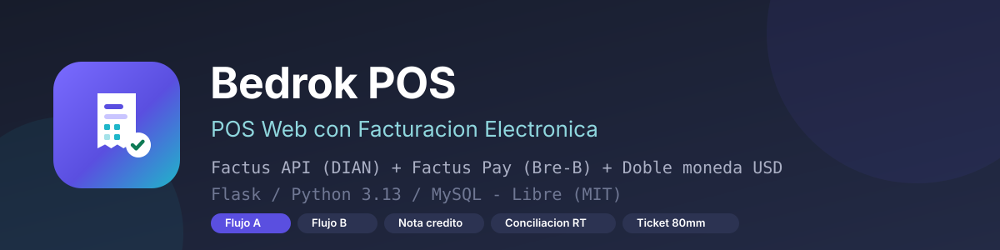
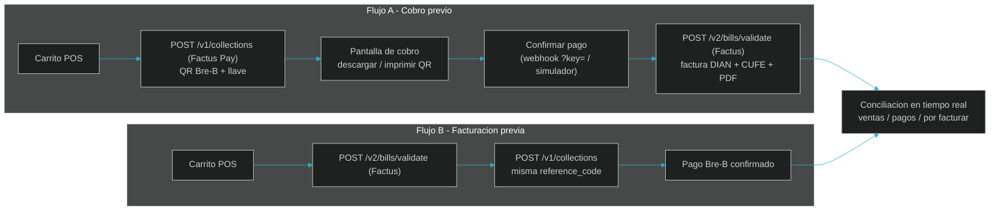

# Bedrok POS



[](LICENSE)
[](https://www.python.org/)
[](https://flask.palletsprojects.com/)
[](https://developers.factus.com.co/)
[](https://pay-developers.factus.com.co/)
[](https://pay-api-sandbox.factus.com.co/simulator)

**Bedrok POS** es un punto de venta web completo (Flask + MySQL) que integra en la operacion
diaria de un negocio la **facturacion electronica DIAN** con la **API de Factus** y el
**recaudo instantaneo Bre-B** con **Factus Pay**, cubriendo ambos flujos minimos del
**Reto Factus (API Wars 2026)**, con conciliacion operacional en tiempo real, nota credito
para anular factura validada, pedidos internacionales en dolares con doble moneda,
ticket termico de 80mm y login de acceso rapido.

---

## Flujos implementados y verificados en vivo

| Flujo del reto | Estado de este repositorio |
|---|---|
| **Opcion A (cobro previo)**: Recaudo Factus Pay -> confirmar pago -> emitir Factura DIAN | Boton "Cobro previo (flujo A)" en el POS. Al confirmar el pago (webhook / simular en el simulador / conciliacion), el sistema emite automaticamente la factura electronica y guarda CUFE, numero y PDF. Verificado: factura `SETP9900334…` VALIDADA. |
| **Opcion B (facturacion previa)**: Factura DIAN -> recaudo con la misma referencia -> confirmar pago | Boton "QR Bre-B (flujo B)". La factura se emite primero (HTTP 201 DIAN), luego se crea el recaudo Bre-B con la **misma `reference_code`** y el QR queda asociado a la factura (trazabilidad automatica). Verificado: `factus_status: 201` + recaudo `ready`. |
| **Opcional: nota credito para anular factura validada** | Boton "Nota credito" en el historial sobre facturas VALIDADAS. Usa `POST /v2/credit-notes/validate` con rango de NC, concepto de correccion 1 y los items de la factura original. Verificado: `NC1997` registrada y validada por la DIAN. |



---

## Caracteristicas

- **POS web**: busqueda de productos, carrito, cliente, IVA (19/5/0), **efectivo con calculo
  de cambio** y cobro con QR Bre-B en los dos flujos.
- **Factus API**: emissao/validacion de factura electronica (2.0), almacenamiento de
  CUFE, numero DIAN, PDF publico, bitacora de solicitudes y respuestas en MySQL.
- **Factus Pay**: creación de recaudos (Link/QR/Llave Bre-B), expiración configurable,
  **webhook seguro con llave y comparacion de tiempo constante**, e **idempotencia** (no se degrada un pago confirmado).
- **Ticket termico 80mm**: vista imprimible con QR de pago Bre-B y **QR + link de verificacion oficial**.
- **Pedidos internacionales**: cotizacion COP, cobro en **USD** con tasa de cambio **en vivo** de API publica
  (fallback gratis incluido), cambio en USD y equivalencia en COP, y factura DIAN en **doble moneda**
  (`currency.type=USD` + `exchange_rate`).
- **Conciliacion en tiempo real**: panel con ventas del dia, validadas DIAN, recaudos confirmados,
  monto recaudado, pendientes de facturar y refresco automatico de 20s + conciliacion manual (pull).
- **Login** (admin/admin), ingenieria de UI propia (icon SVG sprite, animaciones, formato de
  moneda colombiana, favicon propio generado con Pillow).
- **Arquitectura profesional**: paquete `app` con rutas/servicios separados, credenciales solo en `.env`, seed y pruebas E2E en `tools/`.

## Estructura del proyecto

```
Tienda_bedrok/
├── run.py                    # python run.py
├── .env.example              # plantilla de credenciales (secreto: crear tu .env)
├── requirements.txt
├── LICENSE                   # MIT
├── app/
│   ├── __init__.py           # factory create_app()
│   ├── database.py           # MySQL + init_db (tablas y migraciones)
│   ├── utils.py              # formatos COP/miles
│   ├── services/
│   │   ├── factus.py         # OAuth2 + bills/validate + credit-notes (DIAN)
│   │   ├── factus_pay.py     # /auth + /v1/collections (Bre-B)
│   │   ├── cambio.py         # tasa USD/COP en vivo (APIs publicas)
│   │   └── recaudos.py       # persistencia recaudos + datos ticket
│   └── routes/
│       ├── auth.py           # login/logout + proteccion global
│       ├── pos.py            # POS web + facturar clasica
│       ├── clientes.py       # CRUD clientes
│       ├── productos.py      # CRUD/inventario
│       ├── facturas.py       # historial/ticket/PDF/nota credito
│       ├── pagos.py          # guardar-factura (B), cobro previo (A),
│       │                     # api/recaudo, webhook, conciliacion, salud
│       └── pedidos.py        # pedidos internacionales USD (doble moneda)
├── templates/                # base (sidebar) + vistas + ticket 80mm
├── static/css | js | img     # design system, sprite SVG, favicon Pillow
├── docs/img/banner.svg       # banner del repo
└── tools/                    # seed.py, e2e_venta.py, retos.py, check_retos.py, gen_logo.py
```

## Requisitos

- Python 3.10+ (probado en 3.13)
- MySQL / MariaDB en local
- Crear tu `.env` a partir de `.env.example` (en este reto se entregan credenciales sandbox del proyecto, no se versionan)

```bash
pip install -r requirements.txt
copy .env.example .env     # completa DB_* y FACTUS_PAY_WEBHOOK_KEY
python run.py
# login con admin / admin, luego en http://127.0.0.1:5000/pos
```

## Endpoints principales

| Metodo | Ruta | Funcion |
|---|---|---|
| POST | `/guardar-factura` | Flujo B: valida y envia la factura a Factus, crea recaudo Bre-B con la referencia |
| POST | `/crear-cobro-previo` | Flujo A: crea recaudo Bre-B y deja lista la emision automatica al confirmar pago |
| GET  | `/api/recaudo/:ref` | Estado del recaudo (emitido manualmente tambien emite factura pendiente de Flujo A) |
| POST | `/webhooks/factus-pay?key=LLAVE` | Webhook oficial de pagos Bre-B (resp 2xx en <10s) |
| GET  | `/api/conciliacion` · POST `/api/conciliar` | Panel de operacion del dia y conciliacion manual |
| POST | `/facturas/:id/nota-credito` | Nota credito de anulacion (validada por DIAN) |
| POST | `/guardar-pedido` | Pedido internacional en USD con doble moneda Factus |
| GET  | `/api/tasa` | Tasa USD/COP en vivo (cache 10 min + fallbacks) |
| GET  | `/ticket/:id` | Ticket termico 80mm imprimible |

## Imagenes del sistema

| POS Web | Cobro Bre-B | Ticket 80mm |
|---|---|---|
|  |  |  |

*(los jaleos oficiales se generan al ejecutar `python run.py`; la imagen superior es la identidad del producto)*

## Credenciales del sandbox del reto

Las llaves de Factus y Factus Pay del proyecto van en `.env` y **nunca en el repo**
(principio de seguridad de llaves del checklist). El servidor sandbox tiene
minimo **$10.000 COP por recaudo** (validado en pruebas) y el simulador de pagos:
https://pay-api-sandbox.factus.com.co/simulator

## Licencia

[MIT](LICENSE) - Código abierto (2026, Martin Elias Escudero De Vivero, Bedrok POS, reto Factus/Halltec).
